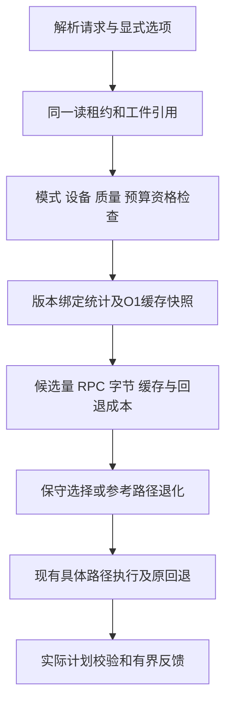

# P4 自适应查询策略选择设计

日期：2026-10-23。状态：**设计待实施**。本轮只编写文档，不改变业务代码、默认选项或已完成的验收结论。实施入口：[任务计划](../superpowers/plans/2026-10-23-p4-adaptive-query-strategy.md)。

## 1. 目标、方案与范围

根据过滤通过率、ANN候选及扩展成本、RPC传输成本、计算节点本地缓存状态，在**合法且具有适用质量证据**的执行方案中选择预计成本较低者。决策必须可解释、可关闭、失败有界；统计估计错误最多影响性能或触发现有明确错误，不能绕开租约、存储过滤或候选完整性校验。

比较三种方案：

| 方案 | 优点 | 代价/结论 |
| --- | --- | --- |
| 固定过滤比例阈值，如1%以下先过滤 | 简单、适合实验消融 | 忽略相关性、K、缓存、消息数和网络条件；不作为产品决策器 |
| 版本绑定统计＋显式成本模型＋有界观测反馈 | 可解释，复用已有计划/计数，可测规划开销 | 需要独立校准和冷启动退化规则；**本设计推荐** |
| 在线试跑两路径、bandit/学习型模型 | 可能探索未知负载 | 查询成本翻倍或引入探索损失，质量选择偏差和复现更复杂；后置 |

以下范围是依据现有代码提出的首期方案，并非用户已批准的实现细节：

- v2向量查询显式 `path='auto'`；默认仍CPU `mode='exact', path='filter-first'`。固定路径不进入规划或反馈流程；启用策略服务时仅增加一次O(1)活跃向量请求计数的增减，须单独测其开销。
- CPU端在exact/filter-first、ANN/filter-first、ANN/search-first中按**原请求语义**枚举。`mode=exact`只剩exact，绝不自动变ANN；`mode=approx`且`fallback=error`不得选择exact。
- ANN自动选择首期要求 `index_source=published`、当前CPU工件已加载、只读策略文件已配置；不在查询中训练、加载索引或生成统计。固定local路径仍兼容。
- GPU仍显式 `device=gpu,path=search-first`；首期 `device=gpu,path=auto`拒绝并说明CPU auto范围，不隐式迁移CPU/GPU。保留现有固定GPU与显式设备回退。
- 不自动改变缓存容量/开关、字段投影、separate/fused选项、ANN候选/nprobe质量预算或执行中路径。只把这些**已确定条件作为成本输入**。执行中仍允许原有候选扩展和exact/error回退。
- 不做跨节点共享反馈、谓词结果/Top-K缓存、表级revision、增量索引或新的存储统计RPC。完整谓词匹配行数是统计信息，不替代实际过滤。

## 2. 代码现状与可复用边界

| 代码 | 当前行为 | 设计要求 |
| --- | --- | --- |
| `compute/vector_execution.py::execute_vector` | BeginRead后固定版本并持有索引；内嵌exact和两条ANN路径；FF物化allowed_rows/map；SF扩展候选 | 在租约/工件已绑定之后、第一次scan/search之前规划；抽取小型资格解析模块，不重写检索算法 |
| `query/search_options.py` | 只接受两种固定path；exact只允许FF；fused要求approx/SF | 新增auto合法组合，不改变旧默认；规划产物必须是已验证的具体path/options |
| `query/quality_policy.py::QualityCatalog.resolve` | 绑定索引、工件、metadata_sql、K、path、向量范围和预算下限 | 对每个候选独立resolve；禁止跨路径复用同一质量profile |
| `compute/lease_io.py` | 租约带N、版本、epoch/TTL；逐RPC统计序列化字节和等待 | 继续同一租约完成所有工作；不以采集统计为由增加BeginRead/全表scan |
| `storage/database.py::_begin_read/_scan` | BeginRead取得总行数N；scan在数据库队列物化完整匹配元数据 | N不是匹配行数M；读取scan首帧也不能当作低成本抽样。规划不能偷读DuckDB或COUNT一次再丢弃结果 |
| `cache/vector_cache.py` | process_snapshot已O(1)，_scopes已有各scope条数；stats(db)仍遍历 | 添加同锁O(1)scope快照和条目丢失序号；不调用stats、不遍历向量或复制缓存 |
| `compute/data_reader.py` | 请求局部hit/miss/admit/eviction、实际向量服务数 | 提供有界反馈，不以全局计数差代替请求计数；fused未通过过滤的lookup不能当作需重排向量 |
| `compute/sql_service.py / rpc/sql_client.py` | 请求选项合并、能力缓存、完成帧确认、总deadline | 增加auto能力及完成确认，防止旧服务静默忽略；计划必须显示实际采用的策略 |

当前FF允许行物化及存储scan并非整个进程内存有界。新增规划器可以限制自己新增的内存，并依据估算排除自动选择的大FF，但不能因此声称服务RSS受到硬限制。

## 3. 实测依据与不能据此得出的结论

### 3.1 最新快照优化后的成本

来源：[2026-10-23快照验收](../validation/cache-stats-snapshot.md)，实现644ea19；i9-14900HX、Linux7.2.11、CPU128维、10万行、串行、本机gRPC。P50/P95为三次重复各分位数的中位数。

| 负载/已固定选项 | 缓存关 P50/P95 ms | 缓存开 P50/P95 ms | 意义 |
| --- | ---: | ---: | --- |
| 100%/K100、8 MiB、projected/separate | 52.39/69.63 | 49.46/67.75 | 命中率0.1890，仍读324.395向量/查询；不能只看开关就按全命中估算 |
| 100%/K100、64 MiB、projected/separate | 52.40/68.15 | 41.31/48.25 | 热集42785条、43812864记账字节，暖态不读向量；容量足够与重复负载共同产生收益 |
| 100%/K10、64 MiB、projected/separate | 31.31/43.62 | 30.39/38.77 | 小候选集减少传输后端到端改善较小 |
| 同上、projected/fused | 30.15/37.10 | 35.35/39.50 | fused与缓存并不必然更快，首期不强制切换 |

42,785条缓存下旧分库统计单次P50 16.481ms、新process快照0.000435ms；此为独立调用微基准，不能作为新规划器开销预算。完整841项真实GPU回归通过，但本次性能只测CPU串行/容量，不包含新策略。

### 3.2 路径反转与昂贵精确路径

[2026-10-14质量成本](../validation/ann-recall-optimization.md)的10万行、固定质量配置、无新数据缓存、并发1：FF/SF P50在0.1%为17.29/215.44ms、1%为26.76/51.46ms、10%为42.99/20.99ms、100%为147.88/24.91ms。低通过率SF仍有55次RPC的短实验案例。这只能说明路径有交叉点，不能把1%或10%硬编码成通用阈值；硬件、源码、质量预算、缓存条件和样本数量不同。

直接核对 `results/p4-cache-data-cpu-20261019-final/report.json` 的exact探针：case22/26（10万行、100%、K100、cache off、projected），warm P50约8033.26/7804.83ms；case20/24（0.1%、K10）为42.49/48.80ms。每阶段仅1查询×3重复，不能输出稳定P95，但足以提醒：高通过率RPC精确扫描可能以秒计，不能将ANN的几十毫秒成本用于exact预算，也不能轻率安排全矩阵200条exact查询。

旧实验只用作设计依据和估算实验工时。**生产策略系数与正式对照必须在实施后同源码、同质量、同硬件和网络类别重新校准**；不直接拼接三个时期的延迟拟合模型，不宣称当前已具备自适应收益。

## 4. 请求契约、资格优先和退化

建议用户入口（均待实现）：

```sql
SELECT id FROM items WHERE value < 10000
ORDER BY vector_distance(vector, [/* 实际维度向量 */]) LIMIT 10
SETTINGS mode='approx', path='auto', metadata_projection='projected';
```

计算启动配置新增 `--adaptive-policy <json>`、`--adaptive-mode apply|shadow`（默认apply，只作用于auto请求）、`--adaptive-network-class <label>`（加载策略时必填，与校准声明一致）。策略文件按服务启动冻结，修改后重启生效；默认不加载、不启用auto。shadow仍只有一次实际执行，运行符合资格的参考路径，同时记录建议方案；不暗中执行另一条查询。

| 条件 | 处理 |
| --- | --- |
| 固定path | 完全沿用原行为，无模型加载要求、无规划/反馈调用 |
| exact＋auto | 归约为exact/FF，reason=exact_only；不索取ANN质量/统计，不选择ANN |
| approx＋auto但无策略文件、非published、GPU | FAILED_PRECONDITION或选项校验错误，给出具体reason；不是无声使用默认参数 |
| 缺失/未加载索引 | 保持既有exact/error回退；不尝试加载/训练 |
| 权威工件损坏、DATA_LOSS、非法维度、显式profile预算冲突 | 按原错误失败，不降级伪装成功 |
| 显式quality_profile_id | 只允许其适用路径参加ANN选择；仍逐项resolve，不忽略用户指定ID。策略映射中的非显式profile与显式预算冲突只排除该候选；如果所有ANN候选均因此冲突则INVALID_ARGUMENT，不借exact掩盖冲突 |
| 未指定quality_profile_id | 从策略中该精确谓词/K/工件的FF、SF profile映射取候选；每项仍由QualityCatalog校验 |
| candidate_data_path=fused | 仅SF ANN有资格；不为节省成本主动选FF或exact，执行后的原exact回退语义保留 |
| candidate_data_path=default | 采用当前启动设置；SF可fused，FF始终separate；不把default改成新auto传输策略 |
| 无可用质量证据 | 若允许exact，选择exact并记录quality_unavailable；否则明确失败。固定未配置质量的ANN仍可按旧方式使用 |
| 成本/基数缺失或失效，但候选仍合法 | 参考顺序FF ANN→SF ANN→exact，仅选择实际有资格者；reason=insufficient_cost_evidence；都无资格则失败 |

“允许exact”仅指 `mode=exact` 或 `mode=approx,fallback=exact`（且无上述fused主动选择约束）。选择exact是planned_exact_choice，不算“ANN成功”；执行后遇候选不足的exact回退另外统计。`fallback=error`不能被规划器解释成“可以主动选exact”。当前FF在实际M≤256且fallback=exact时会转exact；模型必须预测这一既有分支，不把它当作纯ANN成本。 内部planned exact的具体options清除不适用的quality_profile_id并设置mode=exact/path=filter-first，但原请求及完成帧仍保留用户requested_id、requested_mode/path与planned_exact_choice原因；不能因为内部归约漏掉客户端质量确认。显式profile/预算硬错误在归约之前处理。

## 5. 四类决策输入及数据来源

### 5.1 版本与身份

统计键使用 `storage_epoch/database_id/table_id/revision/schema_version/dimension/metric` 加规范化完整 `metadata_sql` 的SHA256；不能忽略WHERE常量或把AND/OR拆开相乘。使用 `VectorPlan.metadata_sql`，不再用正则分析SQL。工件/成本键还包括artifact_id、payload_sha256、构建指纹、具体path、有效ANN参数、K、投影字段、fused/cache/scan_admission状态及并发档位。

离线持久统计绑定数据/工件身份，不把临时epoch写成跨重启通用凭证：加载后先与当前租约、权威工件完整身份匹配，再绑定新epoch。运行时反馈严格绑定epoch和计算服务实例，不跨重启恢复。相同revision重新发布不同工件：数据基数可复用，但候选/检索成本和质量证据必须重新匹配；不同库、重建表、其他表写入导致的数据库revision变化都保守失效。

### 5.2 过滤比例 s=M/N

来源优先级：同版本完整FF/exact执行的实际matched_rows → 绑定同工件数据的离线完整谓词基数 → unknown。离线工具通过已有租约/元数据RPC取得M，并计入**校准成本**；不访问存储目录。未知时使用区间[0,N]，不默认50%、不从SF已命中的候选数推断M。

N由当前租约给出，M必须在[0,N]；当前版本两个完整扫描的M冲突时丢弃统计并报告统计异常，不能改查询答案。只有完整、成功、未取消的FF/exact能更新M。策略所说M=0或M<K仍是规划输入，真正的空结果/不足K必须由同租约实际过滤或候选完整覆盖证明，不能直接返回空。

### 5.3 候选量、相关性与不足概率

分别定义：M为全表满足谓词的数量；L_r为第r轮请求候选数；U_r为该轮**新增去重候选**；q_r为这些新增候选的过滤通过率；V为实际重排的向量数。通常 `q_r != s`，相关分布下尤其不能用K/s保证结果数量。

预测使用被冻结配置下的候选轮次模型：q_r、U_r/L_r、轮次终止/预算耗尽概率，来自独立校准和同scope/路径/预算的已完成观测。没有q证据时s只能作为低置信度独立性先验，区间须扩宽；`ceil(K/s)`仅作诊断，不直接设置L或预算。

模拟现有调度：`budget=min(pool,max_candidates或max(4096,8*min(K,N)))`，`L1=min(budget,candidates或max(64,4*min(K,N)))`，后续L和nprobe按原规则翻倍且截断；pool为FF的M或SF的N，max_rounds保持原选项。有效参数先经QualityCatalog.resolve；不因预测“容易”而降低质量预算，也不因预测“不够”偷偷突破显式上限。缺少预算配置的默认行为与当前代码一致，包括max_rounds默认6的实际校验语义。

SF模型计入 `P(exhaust/error/fallback)` 与已花费的候选成本；fallback=exact时再加后续精确成本，fallback=error时记录失败风险，不把错误当作低延迟胜者。没有实际覆盖全部候选空间时，nprobe=nlist、返回数量不足L或某轮没有新ID均不证明全局完整。

### 5.4 缓存：scope驻留、重复证据、竞争

不能用process总条数/全表N推导当前查询命中率，也不能使用当前请求执行完成后的命中率作该请求的事前输入。

新增 `scope_snapshot(scope)`：在既有锁内用 `_scopes.get(scope,0)`取得条数/向量payload；同时复制process容量、活动工作区、admission_generation和新增loss_generation。每次 `_drop`、clear、close导致可能失去条目时推进loss_generation；允许跨scope误失效，避免昂贵维护。快照和规划均不遍历缓存。O(1)指锁内工作量，非并发墙钟等待保证。

缓存预测分三档：

1. cache off、该scope为空、工作区已满或版本不匹配：h=0（工作区快照只是瞬时提示，实际准入仍由batch决定）。
2. 相同查询向量字节摘要＋谓词/K/具体路径/有效预算的成功历史，全部重排向量在该请求中被命中或成功准入，且其起止及当前loss/admission generation一致：可以预测下一次重复h≈1。必须用 `vectors_served_from_cache + admitted_rows + duplicate_inserts` 对实际rerank向量量核验，不用fused的全体lookup_rows；扫描不准入、工作区bypass或途中淘汰不能形成此证据。它是候选重复的预测，不是返回答案的许可。
3. 其他情况：可显示同scope/具体路径近期实际hit/miss估计，但未校准的跨向量泛化不参与乐观决策；保守h=0，并提供[0,1]不确定区间。容量小于预计工作集、近期频繁淘汰时扩大区间。`resident/M`最多作完整扫描命中上界，不是期望命中率。

反馈只存标量、摘要和最多32轮聚合，不存候选ID、过滤结果、向量或Top-K。不同候选方案分别估计h；FF与SF可能访问不同向量，不能共用某条路径的命中承诺。查询摘要计算O(d)，计入规划成本。

### 5.5 传输和资源

设 `b=min(1024,floor(1MiB/(4d)))`，预计向量miss为 `V_miss=V*(1-h)`，向量裸字节 `B_vec=4d*V_miss`。最终预测B还包括请求ID、元数据字段、控制帧和Protobuf封装，依据相同投影/类型的实测字节率；不能只用裸向量代替rpc_payload_bytes。

separate每候选批通常有过滤RPC，只有该批存在miss才有FetchVectors；fused可将指定miss合入同一响应，但可能因4MiB响应拆分。`ceil(V_miss/b)`只是下界，不能冒充实际miss批数：采用校准的每轮/批布局，未知时保守按所有非空批都miss。BeginRead/EndRead和必要能力RPC始终计入公共成本，不能因cache hit删除过滤或租约。

RPC等待包含服务SQL、排队、序列化和网络，不能直接当RTT或用B/rpc_wait估带宽。模型使用经对照拟合的“每类调用固定有效成本＋每Protobuf字节边际成本”，只在校准的网络类别内有效；不宣称真实网卡带宽。队列负载/并发档位无证据时扩大预测区间，不额外探测存储。

成本部署上下文另有明确来源：启动时读取CPU型号/架构、Faiss/NumPy/DuckDB/SQLGlot版本及执行线程配置，形成hardware/software fingerprint；无法取得或与文件不一致则cost unknown。网络类别由部署者通过`--adaptive-network-class`声明并与文件精确匹配，不从RPC等待推断，不会自动发现跨机链路变化。服务增加活跃向量请求计数（包括fixed、exact、auto，普通SQL不计）；请求进入向量分支后增一、所有退出路径finally减一，规划前取一次包含本请求的快照。桶为1、2—4、5—8，超过8或无对应校准数据则unknown；客户端配置的并发数只作实验标签，不能当运行时计数。模型失配只失效成本，不改变质量资格。

FF还需估计allowed_rows/map及selector临时内存；建议auto候选工作集预算64MiB（配置值，非RSS硬限），超预算的ANN/FF不参与自动选择。不能据此拒绝原有显式FF；exact仍按当前实现执行，存储端元数据物化的实际内存必须测量。

## 6. 成本模型、选择规则与反馈边界

对候选a预测：

`T_a = T_common + T_planner + T_rpc_sql_transport(a) + T_selector(a) + T_ann(a) + T_rerank(V,d) + T_cache_lookup_copy_admit(a) + T_queue(a) + P_fallback(a)*T_remaining_exact`。

- exact：V=M，扫描/向量批成本随M增长；filter-first ANN：读取M行元数据、建一次selector、检索和重排候选；search-first ANN：按轮读取U_r候选元数据，只重排通过过滤者。
- `T_rpc_sql_transport`由调用种类、候选规模/完整扫描规模、B和批数联合拟合。native/selector/rerank/cache使用不重叠分项；**不能再把完整rpc_wait_ms加上SQL/传输分项，不能将嵌套faiss/native两项重复相加**。
- 系数非负，使用现有NumPy离线拟合（归一化特征的非负最小二乘；拟合方法/参数和原始特征入报告）；按硬件/依赖/网络/并发/预算覆盖范围分桶，记录校准残差p90。先将恒定/重复/线性依赖特征并入可识别的总项或移除冗余列，保存列映射和秩诊断；剪枝后仍欠定、无法覆盖所需输入或验证误差超界的模型不发布；不把系数当可迁移物理常数。不新增ML运行时依赖。 建议成本内部验证门槛：绝对误差除以max(实际ms,1ms)，中位数≤20%、p90≤40%；达不到则该成本桶unknown，保留原始残差而不靠最终500条留出调参。此门槛与选择收益护栏分开记录。
- 每候选输出点估计与预测区间；区间是经验残差范围，不是统计置信保证。无覆盖输入标成unknown，而非0ms。

对于`fallback=error`先做风险分层：冻结校准的独立查询（≥500个不同向量，重复不重复计数）中记录预算耗尽/不足错误率，按95% Wilson上界计算p_failure_upper。上界≤1%的候选为低风险层；unknown或高于1%不能因更快而击败低风险层。若至少一个低风险候选，仅在该层按下面的参考顺序与成本比较；若一个也没有，保留原合法参考路径并标记risk_unknown_or_high，不按失败耗时排序，实际失败仍明确返回。此1%是建议风险护栏，不是运行时成功保证。在线出现预算耗尽的候选在该条历史TTL内降为unknown；错误只更新独立风险标量，不能作为正常耗时样本。`fallback=exact`则保留预计候选花费及后续exact成本，缺少失败概率证据时扩大成本区间，不把回退成本置零。

决策按资格→成本→保守差距进行：参考路径为合法FF ANN，其次SF ANN，再次允许的exact。只有替代方案上界比参考下界至少低 `max(2ms, 10%*参考下界)` 才切换；差距不够选择参考并记录uncertain/tie。这些是**建议初始护栏，待校准验证**，不是实测最佳阈值。每个请求重新决策，不在线试跑、不持久缓存已选path，不用平局随机分流。

模型策略文件：format_version=1、policy_id、SHA256、硬件/依赖/网络类别、适用N/d/K/并发范围、数据/工件身份、完整metadata_sql、FF/SF质量profile映射、有效选项指纹、基数/候选统计、成本系数和残差、校准/留出摘要；最多2MiB、64个workload，metadata_sql单项≤64KiB。启动时完整校验，在Landlock前加载但禁止取自storage data-root；大小/NaN/负系数/重复键等错误拒绝启动。它不是质量profile替代物，质量目录仍独立校验。

运行反馈：每计算节点私有，最多256个条目、每条逻辑记账8KiB（合计2MiB），只存固定schema有界数据；TTL300秒，懒过期/LRU每次最多移除一个条目。查找/单条更新不遍历全部历史或缓存，锁内不发RPC；历史不足即无证据。只接收成功完整查询，失败/取消/超时不当正常低耗时样本。延迟残差EWMA可显示和扩大预测区间，不自动减小冻结离线区间或改ANN预算；基数、同查询缓存重复证据可更新。相同冻结输入快照必须产生确定性决定。

成本文件不匹配但可执行候选仍合法时，以参考路径退化并记录；质量不匹配按第4节处理，不能把“成本失效”和“质量失效”混成一个宽松开关。请求总deadline包含规划、执行和反馈；剩余期限不足就失败，不能为规划另开时间预算。

## 7. 接入顺序与可观测性



`compute/adaptive_planner.py`只负责纯决策；`compute/planning_inputs.py`负责租约/引用/质量/统计组装；`query/adaptive_policy.py`管理只读文件；`compute/planner_observations.py`管理有界历史。具体执行器只收到 `ResolvedPlan(mode,path,options,quality_description,decision)`，options必须是具体固定path；extract不得改变原fixed执行顺序或异常优先级。

新增 `execution_plan.adaptive`，保留plan_version=1的已有字段含义：

- version、requested_path、policy_id/hash、apply/shadow、decision_reason、reference/proposed/executed_plan；`requested_path=auto`但`actual_path`始终具体路径。
- scope/工件身份、s和M来源/区间、候选轮次/U/q/不足风险、每方案质量资格和排除原因、预算指纹。
- cache scope条数、generation、h来源与区间，预计RPC/B/内存/成本区间；缺失值为null，不能虚构扫描行数或在线Recall。
- planner_ms（收集输入到决定）、feedback_ms、planning_extra_storage_rpc_calls=0；预测/实际残差；实际精确选择与执行后回退分别标识。

EXPLAIN只解析、取租约/索引元信息及现有统计快照，既不扫描/检索、不填缓存，也不更新反馈/LRU。建议历史查询接口支持peek，避免EXPLAIN污染实验。ANALYZE仍执行一次。shadow只执行参考方案一次，不能用建议方案的成本覆盖真实计数。

能力JSON新增 `adaptive_planning_version=1, adaptive_devices=['cpu'], adaptive_mode, adaptive_policy_id`；不需要新增存储RPC或更改旧proto字段含义。客户端对包括会话 `.search path auto` 在内的auto请求进行能力检查，并在完成帧核对adaptive.version、requested_path、mode/policy和实际path；旧服务/同地址重启后能力过期必须失败或重新确认，不能误当成功。普通SQL和v1不做auto确认。

## 8. 正确性、质量与生命周期验收

每项都是待执行条件，不能把设计写成通过记录。

| 编号 | 输入/故障 | 通过条件 |
| --- | --- | --- |
| A01 | 默认、固定path、exact+auto、ordinary SQL、v1 | 原默认及固定结果/预算/调用链不变；exact+auto只exact；固定请求规划调用数0 |
| A02 | 过滤率0/极低/100%、M<K/K=1/100、AND/OR/Unicode/大int64/同距 | exact逐项等于独立NumPy真值；ANN过滤/顺序/去重/距离正确；不足K必须覆盖证明或原exact/error行为 |
| A03 | s与q相反的相关/对抗数据、候选重复、预算耗尽、fallback=error风险层 | 不能凭K/s、nprobe=nlist或空一轮宣告完整；严格不超预算；高风险快方案不得击败低风险慢方案 |
| A04 | 路径profile缺失、只配一条、显式profile、低预算、工件/SQL/K/向量范围不匹配 | 每候选独立资格判定；失败原因准确，质量错误不被成本模型吞掉 |
| A05 | FF/SF预算及profile均合法 | auto输出与**所选路径同参数固定执行**一致，不要求两条ANN路径答案本来相同；exact与真值一致 |
| A06 | 冷/暖/独立向量、8/64MiB、多库、清理、淘汰、bypass、fused未匹配lookup | h估计版本和路径绑定；不得遍历全缓存，不能把未过滤候选当缓存服务向量；估计错误不能改变过滤与答案 |
| A07 | 同请求读旧版本并发写、新revision/同名重建/重新发布工件 | 旧请求持有旧引用；新请求不复用失效统计/profile/cache，读写可见性不变 |
| A08 | 双计算节点不同暖态/历史；计算和存储同端口重启 | 可选不同path，但租约/工件匹配，exact一致；ANN各自满足相应证据。统计冷启动不触发训练/加载 |
| A09 | deadline、取消、坏RPC帧、损坏工件、存储断连、超大响应 | 保持明确错误和有界重试/拆分；无不完整成功结果、无新增资源泄漏；失败不写正常反馈 |
| A10 | EXPLAIN/ANALYZE/shadow、旧服务/能力过期 | EXPLAIN无数据读取/反馈修改；后两者一次执行；auto能力和完成帧校验覆盖SQL与会话入口 |
| A11 | 模型超限/NaN/负值、部署上下文失配、历史256+并发、65535向量条目 | 配置拒绝或有界淘汰；规划无全缓存/历史扫描；返回快照独立、线程安全 |
| A12 | profile单路径分别通过，但自适应混合选择 | 对冻结**完整选择策略**独立留出评估；不能从两条路径平均Recall达标推导自适应达标 |

正式质量门槛采用项目既有“每覆盖workload平均Recall@K≥0.95”的建议值，须作为本阶段发布验收目标再验证，不是逐查询保证。每workload至少500个独立留出向量；分别报告实际ANN、planned exact、fallback exact、错误/不足。纯ANN质量样本不混入exact来抬高Recall；合法结果少于K时分母min(K,M)，空真值单列。未达到的策略/workload不发布性能胜利结论。

## 9. 性能实验、成本控制与发布门槛

### 9.1 数据隔离与公平比较

在最终源码上独立准备：组件质量校准/留出集、成本拟合集、冻结策略评估集；最终策略评估不得与前三者重叠。风险证据可复用组件校准的≥500个不同向量（必须完整记录所有尝试及错误），不复用最终策略留出。建议成本拟合每覆盖workload128向量（96拟合、32内部验证），正式留出500（其中固定200用于计时），重复3次不冒充600个独立查询。每轮固定数据/查询顺序、随机化配置执行顺序、长会话、同工件/线程/内存预算。策略/质量配置在留出前冻结；留出后调参必须生成新版本并换新留出，不能原地挑最优。

先分别采固定exact、FF ANN、SF ANN；auto使用相同候选有效预算。每个被选方案与对应fixed比较实际行为；各路径达到可比质量后才比较速度。构造oracle-best时只在同质量/资源资格集合中事后选最低延迟，称为“离线观测下界”，不是在线可实现基线。

记录P50/P95、吞吐、错误/不足、Recall、候选轮数/量、planned/fallback exact比例、RPC/Protobuf字节、真实hit与预测h、planner/feedback耗时、模型绝对误差/残差、选择频率、相对最佳固定/离线下界regret，以及计算/存储RSS/CPU/工件内存。不能把路径变化后的native成本改善当网络优化。

### 9.2 分级矩阵

- 正确性：1万/10万、独立/相关、s=0.1/1/10/50/100%、K10/100，共40个workload；另设0行/不足K/对抗/并发故障小数据。先每项少量确定性查询做功能验证，不声称正式P95。
- 首批正式CPU成本：10万独立的(0.1%,10)、(1%,10)、(10%,10)、(50%,10)、(100%,10)、(100%,100)，及10万相关的(0.1%,10)、(10%,100)，默认64MiB；补(100%,100)的8MiB容量组，共9组。FF/SF/auto各冷/暖200条×3重复，最多32400计时请求；缺乏合法质量路径的格子标NOT_ELIGIBLE，不能偷偷换exact当纯ANN。
- exact端到端对照首批每格/状态5查询×3重复，最多270条，仅报告中位数/范围、不报告P95；独立NumPy真值和exact正确性测试照常完整验证。全200条exact矩阵保留显式入口，不默认运行。
- 扩展/消融在通过首批后分批运行：选择边界和100%/K100组的并发1/4/8、缓存off/on、0/1/5ms透明延迟代理、冷/暖/独立/热点；代理标明单向延迟而非直接当RTT。分别关闭缓存输入(h=0)、传输项、候选相关性项(q=s)、在线观测，并对比固定s阈值；不重新调整质量参数。
- 微基准：规划历史0/256条、向量缓存0/8191/42785/65535条、1/4/8并发，构造相同planning inputs，验证规划量不随向量条目数线性增加；观察锁等待，不只测纯函数。

按已有8秒exact探针，单个高通过率格子200查询×冷/暖×3就可能约2.7小时，因此不能依据最新ANN 396秒/6720查询去估全矩阵。先10次pilot测每类耗时，报告预计总工时/磁盘与最慢组，再按代表性范围执行；full入口显式选择，允许按完成组恢复且保留失败记录。

### 9.3 建议验收阈值与未达标处理

以下是待验证的工程门槛，不是已经实现的承诺：

1. A01—A12全部满足；最终无PYTHONPATH、要求真实GPU的完整pytest零失败/跳过，不以旧841通过代替新回归。
2. fixed路径新增规划RPC/扫描/历史写入均0；auto规划新增存储数据RPC为0。规划＋输入快照＋摘要＋反馈，在代表性串行负载P95≤0.5ms且不超过该组端到端P50的2%；超限先简化模型/反馈再宣告可用。并发另报告锁等待与尾延迟。
3. 主矩阵auto对同质量最佳固定方案的每格P50比值≤1.10、P95≤1.20作为回归护栏；不是要求每格都提速。对明确交叉点相差≥20%的高置信格子，应选较低成本方案≥90%；不确定格子应显示保守退化。
4. 扩展/突变场景不强求同样提升，但必须揭示超护栏的组、模型失配和成本；不能通过删样本、提升召回预算或禁用失败组冒充通过。
5. 功能正确但性能/质量门槛未过：保留显式实验开关及报告，标记该策略未通过发布验收；默认行为不变。后续GPU自动选择、统计采样RPC或更广并发模型另立设计。

## 10. 实施决策与后置事项

本设计选取CPU路径为首期自动决策空间，冻结传输/设备/ANN参数；用现有观测及离线版本绑定基数避免在线探测扫描。这限制了冷启动任意新谓词的收益，但使增量实现可解释、可验证且不重复支付全扫描。若后续证据显示unknown比例过高，再单独评估存储摘要/采样，不把全COUNT隐藏在当前查询。

待实施前确认具体校准所得模型系数、可发布workload/质量profile和实际实验工时；这些值必须通过新实测产生，文档不填造系数。策略独立开关、未知输入退化和精确基线使这类校准结果不会改变本设计的正确性边界。
