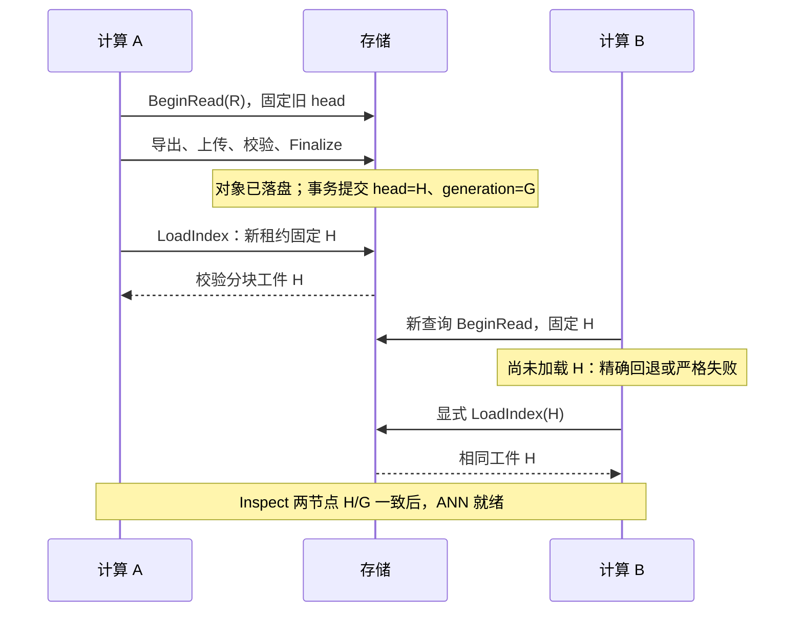

# P4 索引持久化、版本发布与恢复设计

日期：2026-10-16。状态：**实施中，T1—T6已完成，完整验收尚未完成**。初始规划范围由用户指定：结合现有代码制定详细设计与实施计划，包含双计算节点一致性和重启恢复；规划轮次暂不修改业务代码；2026-10-17起按用户授权实施。实施入口见 [执行计划](../superpowers/plans/2026-10-16-p4-index-publication.md)。

## 1. 目标、范围与选择

交付一条可复现链路：显式构建 CPU IVFFlat → 存储侧校验和持久发布 → 两个计算节点通过 RPC 加载同一工件 → 批量写入后的新版本发布 → 旧读完成 → 计算/存储重启恢复。GPU 从已加载的 CPU 工件显式克隆，继续保留 CPU float64 精确基线与重排。

本阶段是 P4 的索引子阶段，不代表全部 P4 完成。数据缓存、自适应策略、表级 revision、增量 add/remove、后台持续训练、GPU 取消调度、多存储副本与共识不在本阶段。批量更新使用已有单条多行 SQL 或托管导入事务；不新增通用多语句事务或批量 CRUD 协议。

| 方案 | 优点 | 代价与裁定 |
| --- | --- | --- |
| **计算侧构建，存储侧校验、保存和发布** | 复用 build worker，保持存储权威；两节点加载完全相同的字节 | 增加上传与验证成本；推荐，首期落地 |
| 存储侧直接训练并发布 | 无上传构建结果的往返 | 把训练负载放到存储侧，需重做资源隔离；首期不采用 |
| 各计算节点持久保存、独立重建 | 改动较少 | 缺少权威发布点，可能同参数不同工件；不满足本期双节点目标 |

一致性目标分为两层：

1. **始终安全**：每条查询的数据、元数据、CPU/GPU 索引均绑定一个有效读租约及其确定的工件；缺少匹配副本时精确回退或明确失败，绝不使用旧索引处理新数据。
2. **显式加载后收敛**：暂停写入/发布，两个节点完成相同版本的加载并通过就绪屏障后，同一快照使用相同 `artifact_id` 和 SHA-256。不同节点在加载期间可分别 ANN/精确/严格失败；不承诺同时完成加载或全局无间隙切换。

## 2. 现有代码依据与接入位置

| 现有实现 | 已具备的基础 | 本阶段所需变化 |
| --- | --- | --- |
| `compute/index_manager.py::IndexManager._build_cpu` | 同租约导出，独立进程训练，预算和取消后发布内存对象 | 提取可复用的“从指定租约构建”内部方法，新增发布/加载入口；保留旧 BuildIndex |
| `index/build_worker.py::build_in_worker` | 单 I/O 线程 communicate、deadline、子进程回收、ID 校验 | 复用训练；加入工件导出、验证工作集测量，不在查询中训练 |
| `index/faiss_backend.py::FaissIndex` | IVFFlat 结构/唯一 ID/有限向量验证，内存 NPZ 序列化 | 新增明确格式的原生 CPU 工件读写及规范化内容摘要；旧 worker NPZ 协议保留 |
| `index/types.py::IndexKey` | database/table/revision/schema/dimension/metric/build 指纹 | 完整保留；新增独立 ArtifactDescriptor，不把发布序号混入数据 revision |
| `index/registry.py::acquire` | 按 snapshot 查本地 active key，并保护引用 | 新增按完整 key 和 artifact_id 获取；published 模式不使用本地 active 推断权威工件 |
| `storage/database.py::_begin_read` | MVCC 事务固定 revision，每库最多 16 租约、最长 60 秒 | 在同一事务读取发布 head，将描述符固定进租约 |
| `storage/database.py::_write` | 数据与 revision、幂等结果同事务提交 | 保持数据写入流程；索引目录事务不得走此方法，否则会错误递增数据 revision |
| `storage/catalog.py` | 单存储进程持有数据库，所有 SQL 经过每库队列 | 接入索引目录；DDL 迁移、发布 CAS、GC 标记均经过同一队列 |
| `storage/sql_service.py` | 8 RPC worker、4 个共享扫描名额；租约信息双层保存 | 增量工件 RPC；目录引用保护以 Database 租约为准，避免把 RPC 缓存当第二权威 |
| `compute/lease_io.py` / `vector_execution.py` | 帧/版本校验，精确回退，实际计划 | 验证发布元信息；按租约选择工件；EXPLAIN 只看元信息，不下载 |
| `index/gpu_registry.py` | 完整 IndexKey 与 worker generation | GPU 额外绑定 CPU artifact_id，克隆时固定 CPU 对象引用 |
| `query/quality_policy.py` | v1/v2 质量配置绑定逻辑 IndexKey | published 模式增加 v3 工件绑定，避免不同原生工件借用相同质量证据 |
| `rpc/p3_acceptance.py`、`tests/integration/test_p3_execution.py` | PTY、隔离、旧租约跨写入/重建、重启检查 | 新建 P4 验收工具，保留 P3 local 模式原验收语义 |

规划时（2026-10-16）没有工件上传/下载协议、发布目录或持久发布状态；后续实施记录见计划文末。内存 serialize/deserialize 不是业务持久化；`.index clear` 也不能直接扩展为删除权威工件。

## 3. 身份、工件格式与权威目录

### 3.1 三类版本

- `revision`：现有数据库级数据版本，SQL 写入成功递增；其他表写入仍保守使索引不匹配。
- `IndexKey`：现有完整逻辑键，构建指纹继续由已解析 BuildConfig、算法、采样策略和 Faiss 版本产生。
- `publication_generation`：数据库内单调递增的索引发布序号，仅 head 变化时递增，初始 0；不代表数据更新。幂等重放或当前 head 不变不递增。

ReadLease 返回的是该 snapshot 的 head generation（无 head 为0），CAS 也比较该 head；分配新值时才使用数据库级序列。其他表的索引发布不会让当前表的 head CAS 无故失败。

同一完整 IndexKey 的已发布原生工件不可被不同字节覆盖。重新训练若得到不同字节，返回 `ALREADY_EXISTS/index_key_content_conflict` 并给出已有工件身份；需要改变构建配置或实现指纹才能发布另一工件。命中已有 key 时优先复用存储工件，不重新训练。更换同快照的构建配置可发布另一 key，并经 CAS 切换 head。

### 3.2 ArtifactDescriptor v1

使用冻结数据类和类型化 Protobuf 表达，下列字段为必需字段：

| 字段 | 含义 |
| --- | --- |
| `format_version=1`、`payload_format=faiss_cpu_ivfflat_v1` | 工件封装及原生格式 |
| `key: IndexKey` | 完整逻辑键 |
| `build_config`、`faiss_version`、`platform=linux-x86_64-le` | 已解析 nlist/seed/train_rows 与兼容环境；首期只承诺当前锁定平台和 Faiss 版本 |
| `row_count`、`nlist`、`payload_size` | 反序列化和资源预检依据，不能仅信任上传声明 |
| `payload_sha256` | 原生工件准确字节的 SHA-256 |
| `snapshot_sha256` | 同租约权威 ID/向量内容摘要，见下文 |
| `artifact_id` | 规范化不可变描述字段的 SHA-256；不含自身、时间、发布序号和运行统计 |

规范 JSON 使用 UTF-8、键排序、无空白分隔符、禁止 NaN；ID/计数均为整数。`artifact_id` 纳入以上所有不可变字段（除自身），因此相同 payload 属于不同数据快照时身份仍不同。描述符最多 64 KiB。发布记录另存 `operation_id`、时间、generation、验证统计和状态；这些不改变工件身份。

payload 使用 `faiss.serialize_index` 的原生 CPU uint8 字节，不压缩，不套 ZIP/NPZ。此格式与当前训练/GPU 管道中的 NPZ 内部封装分开，防止把封装变化误当索引变化。GPU 加载后仍可通过现有 NPZ 管道克隆，来源 artifact_id 单独传递和校验。

`snapshot_sha256` 规范流：固定 ASCII 域标记 `vecstor-index-snapshot-v1`、little-endian uint64 行数与 uint32 维度，随后按 ID 升序逐行写入 little-endian int64 ID 和该行连续 little-endian float32 向量字节。保留 float32 位模式，包括有符号零；禁止非有限值。元数据不进入这个摘要，因为它不是 IVF 构建输入；其一致性由完整 revision/租约保证。该摘要与现有质量证据的 dataset_sha256 是不同概念，不得混用。

存储侧在完整 `StreamVectorSnapshot` 导出时计算摘要，并把完成收据留在该 Database 租约中；最终批次新增摘要字段及完成标记。客户端必须读到正常流结束并核对计数和本地摘要。取消、中断、超时不得生成可发布的完成收据。重复完整导出只允许同一摘要；收据随租约释放。

### 3.3 文件和目录表

拟新增存储私有目录：

```text
data-root/indexes/
  staging/<server-epoch>/<database-id>/<operation-id>.part
  objects/<database-id>/<artifact-id>/index.faiss
  objects/<database-id>/<artifact-id>/manifest.json
```

服务自行生成和校验路径组件，不接受客户端路径；拒绝符号链接和目录越界。staging 与 objects 必须在同一文件系统。manifest 是不可变描述符副本；**数据库目录表是唯一发布权威**，不存在另一个 `current.json` 权威指针。

每个托管 DuckDB 新增内部表，由 `storage/index_catalog.py` 在数据库单线程队列中管理：

- `__vecstor_index_meta`：索引目录 schema_version 与 publication_generation。
- `__vecstor_index_artifacts`：artifact_id、完整 key 的唯一约束、descriptor_json、状态 READY/CORRUPT/RETIRED/DELETED、首次发布序号及最近激活序号；DELETED 保留 key→digest 墓碑，避免回收后重用 key 发布不同工件。相同字节的已删除工件允许重新校验、安装并发布，保持身份不变。
- `__vecstor_index_heads`：完整 snapshot → artifact_id、generation；每快照一个 head，发布时只允许当前数据快照。
- `__vecstor_index_operations`：operation_id、操作类型PUBLISH/PRUNE、原始请求意图及摘要、首次绑定后的规范请求摘要、构建快照、预期 head generation、状态与终态结果/错误摘要；PRUNE没有构建快照，保存固定删除集合。

索引操作 ID 位于独立 API 命名空间；同一索引 ID 不可绑定不同请求。用户 SQL 白名单继续禁止访问内部表。升级在单事务中增加表并记录 schema_version；遇到未来未知 schema_version，拒绝打开该库，不自动降级写入。

## 4. 构建、校验和发布事务

### 4.1 显式发布流程

1. 客户端生成 operation_id；重试首先查询该 ID 的状态，不凭超时推断失败。
2. 计算侧 BeginRead，固定数据快照和当前 head generation；调用 BeginIndexPublication，存储持久保存请求绑定。每库最多 1 个未结束发布；第二个不同发布立即返回资源不足，不占队列等待。
3. 若存储已保存相同完整 key，走已有工件复用及 head CAS；不得用旧本地句柄替代。否则经同一租约完整导出快照，计算摘要，训练或复用内容经过核对的本地 CPU 对象。
4. 上传头固定 descriptor、operation_id、token、预期大小；逐块写 staging，校验偏移、总长和 SHA-256。上传完成状态为 STAGED，仅表示字节齐全，不对查询可见。
5. FinalizeIndexPublication 在受限子进程中解析原生工件，验证类型为 CPU IVFFlat、L2、训练完成、维度、nlist、唯一非负 int64 ID、数量、有限向量、量化器结构和构建指纹。遍历倒排列表提取原始 ID/向量并按规范流求摘要，与存储完成收据比较；只比行数/ID 或只比上传摘要不足以证明同快照。
6. 验证通过后，将 payload、manifest flush/fsync；安装不可变对象目录并 fsync 父目录。已存在相同 ID 时验证相同内容后复用，禁止覆盖。验证和重 I/O 不占 Database SQL 队列。
7. 进入每库队列中的短事务：再次检查租约仍有效、当前 table_id/schema/revision 未变、head generation 等于期望值、操作仍可提交、对象已持久准备；原子写入工件 READY、head、generation 和操作 COMMITTED 结果。此事务是发布线性化点。
8. 返回发布描述符。CPU/GPU 本地加载作为另一显式操作；发布成功不等于任何计算节点已加载。计算侧不因本地加载失败撤销已提交发布。

整个发布从 BeginRead 起使用同一总 deadline，首期最多 60 秒，默认 45 秒；子 RPC 只使用剩余时间，不在上传、验证或 commit 阶段重置期限。若 10 万行目标规模无法完成，报告当前上限并重新设计脱离读租约的快照作业；不得偷偷延长 MVCC 租约。训练 worker、存储 verifier、I/O 临时副本成本均纳入测量。

### 4.2 数据写入与索引发布的关系

数据事务提交为 revision R+1 后，新读立即读取 R+1。若 R+1 尚无发布索引，CPU ANN 按既有策略精确回退或严格失败；不能继续查询 R 的 ANN 后声称 R+1。显式 GPU 的设备回退仍需 device_fallback=cpu 授权。

构建 R 期间如果任意数据写入推进 revision，Finalize 返回 `ABORTED/index_snapshot_changed`；不把 R 工件发布为当前版本，也不自动换租约重试。此前开始的 R 查询仍使用自己的租约完成。批量写入可见到索引可用的时间包含重建、验证、分发和各节点加载，不是实时强一致索引更新。

同 revision 下切换构建配置时，发布更新 head generation；旧租约继续持有旧描述符，新租约取新描述符。发布元数据不递增 data revision。发布竞争的失败方返回 `ABORTED/index_head_changed`，不自动覆盖成功方。

### 4.3 幂等、取消与崩溃窗口

状态机：`RESERVED → UPLOADING → STAGED → VALIDATING → COMMITTED`；任一未提交状态可进入 `FAILED` 或 `ABORTED`。中间状态用于诊断，COMMITTED/FAILED/ABORTED 为持久终态；UNKNOWN 只表示未找到记录。

- 同 ID、同请求的终态重放返回原结果；同 ID、不同规范请求为 ALREADY_EXISTS。请求摘要排除临时租约 token，但包含完整 key、database_id/table、期望 generation 与协议版本；上传 descriptor 一旦绑定不可更改。
- 为使数据更新后的重试也能识别原操作，额外保存调用者最初意图：database_id/table、原始nlist（含未指定）、seed、显式expected_generation（含未指定）、协议版本。查状态命中时先比较意图，再返回首次绑定的key/generation/结果；不能先取新revision重新解析默认nlist，也不能只凭ID就把不同参数请求当作旧成功。存储按收到的意图字段自行计算摘要，不信任客户端提供的摘要。
- 上传中断不续传，记录终态失败并清理临时文件；下次使用新 ID。响应丢失先查状态，COMMITTED 不重建、不重复增加 generation。
- commit 前取消/期限耗尽阻止提交；COMMIT 一旦成功，随后取消只能使响应未知，不能记录失败覆盖成功。操作结果与 head 在一个事务提交。
- 存储重启将遗留未提交PUBLISH操作标记 ABORTED/restart；旧 epoch 的租约和上传 token 失效。PRUNE按第7节继续既定删除集合。未知状态的客户端先查状态，再决定新操作。
- 租约结束/到期时，每库清理器将其未提交操作标记 ABORTED/lease_ended，释放发布准入与收据；上传/验证按总deadline取消并回收预留。清理器不得改写COMMITTED或删除已提交对象，避免客户端断线后永久占用发布名额。

| 崩溃点 | 重启后的确定结果 |
| --- | --- |
| 上传或验证未完成 | 没有新 head；旧发布保留；临时文件清理 |
| 对象 fsync 完成，目录事务未提交 | 没有新 head；对象为孤儿，可清理；不能据磁盘目录自动发布 |
| 目录事务已提交，响应未送达 | 原 operation_id 查询为 COMMITTED，返回同一 generation/artifact_id |
| 新发布后出现磁盘缺失/损坏 | 标记 CORRUPT，新 ANN 请求明确 DATA_LOSS；不把旧 revision 当恢复结果 |

文件持久化和 DuckDB 提交不假装组成跨介质事务：采用“先持久不可变对象，再提交权威引用”，允许孤儿文件，不允许提交成功引用未准备完整的对象。崩溃验收针对本机文件系统的进程故障；不宣称已证明断电、控制器故障或远程文件系统耐久性。

## 5. RPC、准入与错误契约

现有 v1/v2 字段含义不变，新增类型和 RPC 后运行 `scripts/generate_proto.py`。旧服务缺少能力时，新操作在客户端和计算侧均明确拒绝，不回落为内存构建成功。

### 5.1 新增存储 RPC

| RPC | 输入 / 输出与用途 |
| --- | --- |
| `BeginIndexPublication` | database_id、read_token、operation_id、原始请求意图、已解析BuildConfig、expected_generation → operation 状态、完整 key、已有工件（如有） |
| `UploadIndexArtifact(stream IndexUploadFrame)` | 唯一 header + 连续 chunk + 唯一 trailer → STAGED 与接收大小/hash；每帧携带 operation_id |
| `FinalizeIndexPublication` | database_id、operation_id、read_token → COMMITTED 结果；新工件校验/发布，或复用已存在同 key 工件后 CAS |
| `GetIndexPublication` | database_id、operation_id → UNKNOWN/进行中/终态与完整结果；不依赖原租约仍存在 |
| `ListPublishedIndexes` | database_id、可选 table、page_size≤128、cursor → 工件及当前数据匹配状态；分页，不一次返回整个目录 |
| `DownloadIndexArtifact` | database_id、read_token、artifact_id → descriptor + 连续 chunks + COMPLETE；只能下载该租约固定的工件 |
| `PruneIndexArtifacts` | database_id、operation_id、keep_last（默认2，最小1）、dry_run → 可回收/被保护/实际删除清单与字节 |

ReadLease 追加 `index_publication_version=1`、`publication_generation`、可选 `published_index: ArtifactDescriptor`、`published_index_state=missing|ready|corrupt`。字段存在性必须由版本字段确认；published 模式收到旧租约直接失败。EXPLAIN 可展示 corrupt 元信息但不下载；实际 ANN 访问 corrupt 工件为 DATA_LOSS。普通 exact 查询不依赖工件健康。

SnapshotBatch 追加仅在最终批次出现的 `snapshot_complete`、`snapshot_sha256`。新发布必须具备 v1 完成收据；现有 local BuildIndex 可兼容旧服务器。

### 5.2 新增计算 RPC 与选项

- `PublishIndex`：database_id/table/nlist/seed/operation_id/expected_generation，仅 CPU 权威工件；返回存储发布结果，不隐含 GPU 克隆。
- `LoadIndex`：database_id/table/device=cpu|gpu/gpu_id=0，可选 expected_artifact_id；只加载当前租约确定的工件，绝不训练。给定 expected ID 不匹配时失败，不能加载“最接近版本”。
- `InspectPublishedIndex`：取得新读租约，报告权威描述符、当前节点 CPU/GPU 驻留、generation 和 `ready_for_ann`，随后结束租约；只读，不下载。用于双节点屏障。
- 存储列表、操作状态和 prune 通过计算侧对应代理 RPC 提供，保持终端只连接计算服务。代理传播总 deadline 和取消。
- `GetSearchCapabilities` 增加 `index_publication_version=1`、`index_source`、`quality_profile_versions`。已启动 local 模式也可发布/显式加载，但其查询仍不属于 published 一致性承诺。

计算启动参数新增 `--index-source local|published`，默认 local 保持现有 P3 使用方式。published 模式的 `.index build` 明确提示使用 publish/load，不再暗中产生与权威 head 无关的本地活动索引。默认查询模式始终 CPU/exact/filter-first。

### 5.3 传输、预算与错误

- 工件 chunk 最多 1 MiB，完整 Protobuf 消息最多 4 MiB；header/descriptor 最多 64 KiB。offset 从 0 连续递增，total_size/hash 固定，必须有唯一 COMPLETE/trailer 和正常 EOF；缺帧、乱序、重复、尾随数据全部拒绝。
- 上传/下载每帧检查剩余deadline、取消与租约有效性；传输pin只防文件回收，不延长租约。发布operation_id沿用1—128字符字母/数字/下划线/连字符规则，以(database_id, operation_id)区分不同数据库。
- 默认单工件最大 256 MiB；storage 工件+staging 预算 2 GiB，预留剩余磁盘空间 256 MiB。上传开始即按声明长度预留，额外字节拒绝；失败释放预留。空间不足明确失败，不自动删除受保护工件。
- 存储保持 8 RPC worker、4 个共享重操作名额。Upload/Download/Finalize 同扫描共享这 4 个名额，并额外受全局最多 2 个工件重操作、1 个 verifier 限制；所有准入非阻塞。Begin/GetStatus/EndRead/FetchVectors 不占这些重操作名额。
- 每库最多 1 个发布；计算侧构建/加载合计最多 1 个 CPU 维护任务。保持 CPU 驻留默认 256 MiB/8 条目和估算工作集不超过其两倍；加载估算需包含下载缓冲、原生对象、排序校验副本和已有驻留，超预算拒绝。流分块不等于常量总内存。
- 加载的保守预检式为 `resident_bytes + 3*payload_size + 2*row_count*(4*dimension+8)`，上限为两倍CPU驻留预算；verifier使用去掉resident项的公式再加128MiB新解释器/原生库余量，与512MiB预算比较（2026-10-18实测补入）。整数运算先检查字段范围，拒绝巨大声明；实测发现低估应收紧系数并记录依据，不把估算视为RSS保证。
- verifier 使用新解释器、deadline、内存估算及强制回收；默认 512 MiB 估算预算、1 个任务。它不训练，不打开 DuckDB，只解析 staging payload 与不可变预期描述。实现时测量峰值，不宣称 native RSS 硬限。
- 应用层自动重试保持 0。恢复命令/运维重试先查询持久状态；相同 ID 的重放不能创建第二次发布。

错误分类：参数/未知格式字段 `INVALID_ARGUMENT`；旧服务/兼容版本不符/租约过期/未加载 `FAILED_PRECONDITION`；revision 或 head CAS 冲突 `ABORTED`；ID 请求重绑定或同 key 不同工件 `ALREADY_EXISTS`；预算/队列/磁盘预留不足 `RESOURCE_EXHAUSTED`；缺失已提交对象、字节/结构/内容摘要损坏 `DATA_LOSS`；取消/超时/不可达沿用各自 gRPC 状态。DATA_LOSS、取消、期限耗尽不能通过精确或设备回退吞掉。

## 6. 计算节点选择与双节点一致性

### 6.1 查询固定工件

published 模式执行步骤：BeginRead → 验证 publication_version 与 descriptor → 按 `(IndexKey, artifact_id)` 获取本地 CPU/GPU 引用 → 原查询路径 → EndRead。没有 descriptor 表示当前数据尚未发布索引；有 descriptor 但本地缺失表示尚未加载，分别记录 `index_not_published` / `published_index_not_loaded`。

registry 增加 `acquire_exact(key, artifact_id)`；本地 `_active[snapshot]` 仅用于 local 模式。相同 key 的 local 对象若无对应 artifact_id 不能用于 published 查询，即使 nlist、ID 都相同。LoadIndex 只在完整下载、摘要/结构/内容校验和取消复查后原子纳入 registry；冲突替换不能破坏已 pin 对象。首期同 key 存在未绑定或不同工件对象时返回显式冲突，要求 clear 无引用对象后重试，不原地修改句柄。

GPU 按相同 descriptor 找 CPU 来源和 GPU 副本；同快照其他配置的 CPU/GPU 不能成为设备回退对象。GPU worker generation 失效仍只影响 GPU 就绪，已发布 CPU 工件不失效；`.index load --device gpu` 可恢复，不调用训练。

### 6.2 发布与加载时序



每条查询允许持有发布切换前取得的旧租约；不能因另一个节点先完成新加载而中途换索引。用于比较两节点的测试必须冻结写入/发布，或显式确认两个租约拥有同一 descriptor。两个在不同时间取得的租约不保证 revision/generation 相等。

同一 CPU 工件、相同查询和参数，在锁定依赖/线程条件下比较两节点 ID、距离和实际计划身份；GPU 与 CPU 只比较各自冻结结果、过滤/完整性/召回，不要求其候选逐项相同。

## 7. 重启恢复、旧版本保留与回收

### 7.1 存储恢复

启动时先处理每库索引目录迁移与未终结操作，汇总全部托管库引用后，按目录表核对 READY 对象的 manifest、大小和 SHA-256；完成后才发 ready。任何库目录不能安全读取时拒绝启动，不以不完整引用集删除其他库工件。首期无需在启动重新训练或逐个 native 反序列化；加载时继续完整结构/内容校验。启动校验 I/O 计入恢复耗时。

缺失/损坏对象标记 CORRUPT，目录 head 保留可诊断身份，禁止自动改指向旧 revision。数据 exact 服务可启动并工作；服务 ready 事件带损坏工件数量，ANN readiness 分别报告。修复同一 ID 的字节只能由可信完整备份恢复并重新校验，或按新配置发布新工件；不覆盖现存不可变对象。

存储重启后旧租约全部失效。在途查询失败后由客户端发起新查询，不能复用计算内存索引伪造离线成功。database_id/table_id/revision/已提交 generation 保持持久稳定。

### 7.2 计算恢复

默认重启后内存 registry 为空。提供两种显式恢复入口：

1. 服务启动后 `.index load TABLE [--device cpu|gpu]`。
2. `--index-source published --index-preload FILE`：在 ready 前，按文件列出的 database/table/device 串行 RPC 加载；无文件不预加载。文件至多 1 MiB/128 条，重复目标拒绝；在 Landlock 前读取，不能位于存储 data-root。

预加载格式为 `{ "format_version": 1, "targets": [{"database": "demo", "table": "items", "device": "cpu"}] }`；GPU 目标隐含先加载对应 CPU 工件，只有 GPU 目标时也保留 CPU 来源。每目标最多 60 秒且整个启动预加载最多 300 秒；超过预算、缺工件、加载失败或最后复查 head 已变则退出启动，不发虚假 ready、不自动训练。初版要求维护窗口内稳定目标以获得可重复预热；不启动后台重试循环。

计算不保留磁盘工件缓存，下载进入有预算内存；确认存储侧已验证的工件摘要后，在计算进程中反序列化并复核结构/内容，GPU克隆继续通过匿名管道。该方式沿用现有CPU worker结果的父进程解码模式，减少一次冗余验证进程；原生解码期间不能强制中断，返回前复查取消/期限，原生崩溃仍可能影响计算进程，不承诺敌对工件隔离。复用现有 Landlock 边界，验收需证明计算 A、B 和 GPU worker 不能读取 DuckDB、工件 payload/manifest 或列举存储目录，且 RPC 加载与查询成功。

### 7.3 回收协议

默认按最近激活序号保留每个仍存在的 table_id 最近 2 个不同的已提交工件，另保护当前数据快照的 head、所有有效读租约固定的工件、下载 pin 和正在提交的工件。`.index clear` 只释放计算内存，不删除存储数据；存储回收为单独显式 prune，默认 dry-run，`--execute` 才实施。

已DROP的table_id不再应用keep-last保留，仍保护有效租约、下载pin和进行中的发布；同名重建的新table_id独立保留。引用释放后可回收旧表全部工件，但保留墓碑和操作结果。

GC 在 Database 队列中确认租约及 head，并在短临界区固定删除集合、标记 RETIRED/删除旧 head；随后退出队列删除文件、fsync 父目录，最终标记 DELETED。读取工件时在同一权威检查点建立下载 pin，再打开文件；GC 与 pin 获取必须有共同锁序，禁止先检查无 pin 再无锁删除。

锁序固定为 Database 队列 → ArtifactStore 短锁；持 Store 锁不得等待 Database.call。上传/验证/下载大块 I/O 不持该短锁，不占 SQL 队列。数据库租约固定 descriptor 即提供存储保护，不需要计算节点另报分布式引用。租约到期后不能继续合法访问该工件；计算 pin 仅保护进程内对象。

GC 崩溃时 RETIRED 不可新下载，重启继续删除；残存文件可回收，不能反向恢复 head。工件 key/digest 墓碑和终态操作结果继续保存；大规模目录压缩留待后续，不以 TTL 删除幂等记录。prune 重放返回第一次删除结果，不把后续新增工件纳入原请求。

prune同样使用索引操作幂等表，但operation类型为PRUNE、摘要绑定keep_last及目标数据库。dry-run不写操作记录；execute先在事务中保存固定删除集合，再逐项删除。运行中重试返回进行中状态，重启恢复继续该集合，删除完成后持久保存终态结果。一个artifact正在RETIRED清理时不允许重新发布，待DELETED后才能以相同字节恢复。

## 8. 质量配置与用户操作

published 模式若使用质量配置，要求 `format_version=3`：沿用 v2 的 execution/workload/budget/evidence，加 `artifact_identity={artifact_id,payload_sha256,snapshot_sha256}`；CPU execution 的 gpu_model 固定为 `not_applicable`。目录顶层允许 version 3；v1/v2 在 local 模式保持原行为，published 模式明确 `quality_profile_artifact_unbound`，不能只填新摘要后宣称原证据成立。

v3 发布工具只接受对实际工件完成的验证：固定既有校准参数，用完整不少于 500 条独立留出查询在已发布 CPU/GPU 后端测量并确认零不完整/零精确回退、评估平均Recall≥0.95，且数据身份一致；不少于 200 条、平均Recall≥0.97的校准证据仍必需。复用已见留出集时标注为工件一致性回归，不宣称新独立泛化结论；失败组不导出，不根据留出结果重调参数。旧配置/数据 revision 改变后仍需新证据。

验证工具经计算服务执行单条按ID排序的完整字段SELECT，对实际ID/向量/value计算既有dataset_sha256并核对校准源；该结果revision必须等于工件revision。随后每条评估计划和末尾Inspect都必须保持同一revision/artifact，途中数据或head变化使本组失败。只核对向量snapshot摘要不足以证明过滤属性未变。GPU验证仍绑定真实机型与执行后端。

拟新增命令（**当前尚不可执行**）：

```text
.index publish items --operation-id publish-r1 --nlist 64 --timeout 60
.index published items
.index publication-status publish-r1
.index load items --device cpu --timeout 60
.index load items --device gpu --timeout 60
.index inspect items
.index prune --keep-last 2
.index prune --keep-last 2 --execute --operation-id prune-1
```

publish 从新租约取得 expected_generation；API 使用者可显式指定，终端也提供 `--expected-generation` 用于 CAS 验收。load 可提供 `--artifact-id` 作为预期值。首版无“选择任意旧数据快照查询”命令；list 展示历史不代表旧 DuckDB 数据版本可在重启后恢复。

实际计划新增 `index_source`、`published_artifact_id`、`artifact_id`、`payload_sha256`、`publication_generation`、`published_index_state`、`index_load_state`。published_artifact_id描述租约要求；artifact_id/payload_sha256只描述实际用于ANN的工件，exact或未执行时为null，避免把精确回退显示为工件命中。发布/加载报告另含 export/build/upload/verify/fsync/catalog_commit/download/deserialize/gpu_clone 耗时、字节、进程峰值和是否训练。EXPLAIN 只读取租约元信息；ANALYZE 执行一次。工件发布就绪与质量配置可用分别显示。

## 9. 验收矩阵

所有下列项都是**待实施的验收要求**。正式工具计划为 `scripts/check_p4_indexes.py`，输出目录必须不存在；复用 ServiceProcess/TerminalProcess，所有失败也保存原始事件，finally 回收进程。故障注入仅在测试夹具/受控测试子进程存在，不开放生产网络故障开关。

| 编号 | 场景与操作 | 必须满足的判据 |
| --- | --- | --- |
| A01 | 发布 1 万×128 CPU 工件，A/B 从 RPC 加载 | 相同 key/artifact/hash/generation；两节点纯 ANN 同输入结果一致；计算文件拒读 |
| A02 | 同 ID 重放；同 ID 不同请求；响应丢失 | 只一次提交；重放原结果；异请求拒绝；状态确定后不再训练 |
| A03 | 一次多行 UPDATE 同时改元数据与向量，再发布新 revision | R+1 未发布时只允许明确精确回退/严格失败；发布后两节点加载新版本，不再用 R |
| A04 | A 暂停在已固定 R 工件的查询，写入并发布 R+1，B 加载 | A 返回 R 的完整答案，B 返回 R+1；A 的租约/索引被保护，结束后才可回收 |
| A05 | 同 revision 换 nlist 配置并发布，B 尚驻留旧配置 | 新读固定新 head；B 不得用本地旧 active；旧读可继续旧配置 |
| A06 | 发布期间写入其他表、DROP/重建同名表、模拟 CAS 冲突 | Finalize ABORTED；table_id 不串用；无新 head；失败工件不可见 |
| A07 | A/B 并发发布，上传/Finalize 队列满 | 每库准入明确拒绝，成功者唯一；FetchVectors/EndRead 仍可完成 |
| A08 | A 重启、B 继续服务；A load 或显式 preload | A 无训练加载同一工件，B 不受影响；PID/服务实例改变；导出快照与训练次数均为0 |
| A09 | A/B 同时重启，存储保持；全部进程依次重启 | 显式恢复后身份不变、ANN结果保持；不是依靠存活内存副本或重建完成 |
| A10 | 存储崩溃后在途查询和重启恢复 | 旧 token 失败；新租约有效；已提交 head/幂等结果存在；未提交状态 ABORTED |
| A11 | 在上传、验证、对象落盘后、目录 COMMIT 前后逐点 kill | 与第4节窗口表一致；尤其 commit 后丢响应可恢复 COMMITTED |
| A12 | payload 截断/翻转、manifest 错 key、合法结构但错误向量、未知 Faiss版本 | hash/内容/兼容校验明确失败；无发布/无本地激活；DATA_LOSS 不回退 |
| A13 | chunk 乱序/重复/超长/缺 COMPLETE，ID>2^53，重复或负 ID | 非法流失败、64位ID保持精确；清理临时文件和预留 |
| A14 | 预算耗尽、磁盘写入/fsync失败、验证崩溃、取消/超时 | 旧发布可用；无半成品 head、悬挂 worker、永久锁或预留泄漏 |
| A15 | prune 与旧租约/慢下载并发、GC 各阶段崩溃 | 有引用版本不可删；到期/结束后可删；RETIRED 不能复活；墓碑保持 |
| A16 | 已提交工件损坏后重启 | ANN fail closed、exact 仍可用；不静默退到旧 revision；诊断包含工件身份 |
| A17 | GPU load、worker 死亡后再次 load；计算/GPU worker 隔离 | GPU 来源同 CPU artifact；重克隆不训练；存储文件拒读；失败不破坏 CPU |
| A18 | v1/v2 local 兼容、旧服务缺能力、v3错摘要/旧revision | 原接口不变；published 能力不足拒绝；质量配置不误绑定 |
| A19 | EXPLAIN、ANALYZE、普通 CRUD 在 published 模式 | EXPLAIN 无下载/训练；ANALYZE一次；普通SQL不要求向量工件确认 |
| A20 | preload 缺文件/错表/损坏/预算不足/加载中 head改变 | 不发虚假 ready、不暗中训练；正确配置下达到就绪屏障 |

### 9.1 数据、答案与同步方法

- 单元/故障测试使用 2048 行、4 维，含大于 2^53 的 ID、同距离、空集和不足 K。
- 正式主链路 1 万×128，独立与属性相关两分布；规模验证 10 万×128。固定种子 20261016；过滤通过率 0.1%/1%/10%/50%/100%，K=10/100。
- 版本正确性使用可控小规模全候选 CPU 测试与独立 NumPy 真值；不把一般 ANN 与精确答案逐项相等作为通用要求。正式 ANN 比较相同工件发布前/后与 A/B 的冻结结果，并单独报告 Recall 和完整性。
- 使用 Event/Barrier 或受控测试代理阻塞，确保旧查询已取得租约并 pin 句柄后再写入；不靠固定 sleep 猜测竞态。
- 屏障成功条件：在无并发写入/发布期间，A/B Inspect 返回相同数据库/table/revision/key/artifact/hash/generation，且请求设备 ready；随后执行 SQL 逐项核验计划。节点重新发布/写入则屏障失效，应重新建立。
- 并发 1/4/8；主要生命周期与成本场景至少重复 3 次。CPU/GPU 性能实验分开串行运行，避免互相干扰。

### 9.2 恢复的证明与产物

恢复模式测试要将训练入口替换为必失败桩，或在测试服务中记录并断言 build worker 启动数为 0；同时断言 StreamVectorSnapshot 调用为 0、DownloadIndexArtifact 字节大于 0。仅观察“查询成功/速度很快”不足以证明没有重新训练。

产物包括 `config.json`、`environment.json`、`source-sha256.json`、`events.jsonl`（进程内单调时间及身份）、`cases.jsonl`（SQL/向量/真值/结果/计划）、`artifacts.json`（不含私有绝对路径）、`recovery.json`、`faults.json`、`isolation.json`、服务日志、`report.json`。报告按 A01—A20 记录 PASS/FAIL/SKIP，不把未运行 GPU 写成通过。

成本报告至少包含构建/发布/下载/恢复/克隆时间、索引滞后窗口、各节点就绪时间、RPC Protobuf 字节、磁盘工件和 staging 峰值、compute/storage/build/verifier/GPU worker RSS、显存采样、回退比例和结果不足比例。定义 `lag_to_publish=t_publish_commit-t_data_commit`，`lag_to_ready=max(t_A_ready,t_B_ready)-t_data_commit`；并发数据写入时按 revision 分别计算，不混合事件。

验收命令（脚本已实现，实际证据见[验收记录](../validation/p4-indexes.md)）：

```bash
conda run --no-capture-output -n vecstor python scripts/check_p4_indexes.py --output-dir results/p4-indexes-10k --rows 10000 --dimension 128
conda run --no-capture-output -n vecstor python scripts/check_p4_indexes.py --output-dir results/p4-indexes-100k --rows 100000 --dimension 128
conda run --no-capture-output -n vecstor python scripts/check_p4_indexes.py --output-dir results/p4-indexes-gpu --rows 10000 --dimension 128 --require-gpu
OPENBLAS_NUM_THREADS=1 OMP_NUM_THREADS=1 VECSTOR_REQUIRE_GPU=1 conda run --no-capture-output -n vecstor python -m pytest -q
```

1 万主链路、所有确定性故障边界、CPU 双节点和重启恢复为必过；10 万若超出 60 秒/预算上限，明确记为未达规模验收，不扩大已交付范围。GPU 必须真实设备运行才能计通过。所有进程回收、临时容量释放及 Landlock 双向证据属于最终门槛。

## 10. 依赖与限制

沿用 Conda 锁定 Python 3.12.15、DuckDB 1.5.6、Faiss 1.12.0、gRPC 1.83.1 和 Protobuf 7.35.1；不新增数据库、对象存储、队列或服务发现依赖。

首期只承诺单存储权威、可信网络、同机独立进程；第二计算节点不使存储服务高可用。原生工件校验与子进程隔离用于防损坏及控制故障影响，不宣称能安全接收敌对任意 Faiss 文件。SHA-256 不提供来源认证。CPU 构建 seed/采样配置是可信构建过程的记录，内容摘要能证明输入向量相同，不能证明任意上传者确实按指定 seed 训练了量化器。

资料核对（2026-10-16）：Faiss 官方说明 CPU 序列化/反序列化及 GPU 工件需转 CPU，且原生读取不负责验证文件完整性，因此本设计在读取前校验封装长度/hash并独立验证结构。[Faiss Index I/O](https://github.com/facebookresearch/faiss/wiki/Index-IO,-cloning-and-hyper-parameter-tuning)。Python 3.12 提供文件 fsync 和同文件系统 rename/replace 原语，原子改名本身不能代替文件及目录持久化。[Python os](https://docs.python.org/3.12/library/os.html#os.fsync)。DuckDB 的单进程写入、MVCC 基础与现有每库队列方向一致；本设计不引入第二进程直接写同库。[DuckDB 并发模型](https://duckdb.org/docs/current/connect/concurrency)。

上述资料支持机制选择，不替代安装版本的协议、崩溃和性能验收。初始设计轮只完成文档检查；2026-10-17起实施及后续真实验收另见执行记录，不把设计依据当作验收结果。
